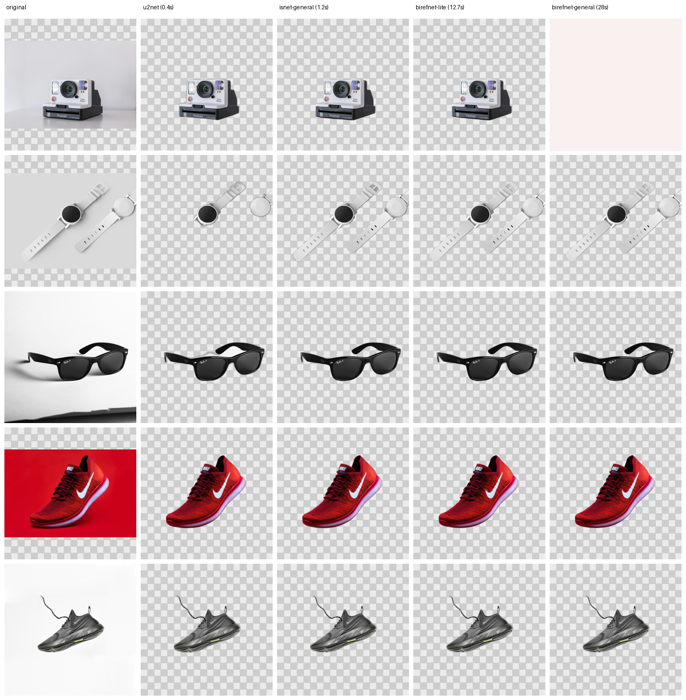

# 누끼 모델 실사용성 검증 리포트 (Usability Benchmark)

> 질문: **"GitHub의 최고 성능 오픈소스 누끼 코드가 실제 상용 플랫폼에 쓸 만한가?"**
> 결론: **예. 상품 사진 기준 상용 수준입니다.** 단, 하드웨어에 따라 모델을 다르게 골라야 합니다.

측정 환경: 본 저장소가 구축된 컨테이너 — **CPU 4코어 / RAM 15GB / GPU 없음**, Python 3.13,
`rembg 2.0.86` + `onnxruntime 1.31.0`. 테스트 이미지 5종(카메라, 흰 시계, 선글라스, 빨간 신발,
흰 신발 — 배경·대비 난이도 혼합).

재현:

```bash
python -m scripts.evaluate samples/input \
  --models u2net isnet-general-use birefnet-general-lite birefnet-general --out samples
```

---

## 1. 조사 — GitHub 상 최고 성능 오픈소스

| 프로젝트 | 성격 | 품질 | 라이선스(가중치) | 상업 사용 |
|---|---|---|---|---|
| **rembg** | 실행 래퍼(모델 16종+ 교체) | — | 코드 MIT | ✅ (모델별 상이) |
| **BiRefNet** (`birefnet-general`) | 현 SOTA급 고해상 분할 | ★★★★★ | **MIT** | ✅ |
| **ISNet** (`isnet-general-use`) | DIS 계열 범용 | ★★★★☆ | **MIT** | ✅ |
| BRIA **RMBG-2.0** (`bria-rmbg`) | 상위 품질 | ★★★★★ | **비상업** | ❌ 유료 라이선스 필요 |
| U²-Net (`u2net`) | 1세대 고전 | ★★★☆☆ | MIT | ✅ |

→ **상업 플랫폼 조합의 정답: `rembg` + MIT 가중치(`isnet-general-use` 또는 `birefnet-general`).**
`rembg 2.0.86`의 기본 모델이 `bria-rmbg`(비상업)이므로, 본 시스템은 기본값을 `isnet-general-use`로
명시적으로 고정했습니다.

---

## 2. 성능 측정 (CPU)

| model | 모델 로드 | **장당 처리** | min | max | 피크 RAM | 비고 |
|---|---|---|---|---|---|---|
| `u2net` | 1.1s | **0.39s** | 0.37 | 0.45 | 1.07 GB | 빠름 |
| **`isnet-general-use`** | 3.4s | **1.22s** | 0.96 | 1.95 | **1.68 GB** | ⭐ CPU 균형점 |
| `birefnet-general-lite` | 8.4s | **12.70s** | 6.86 | 26.44 | 12.09 GB | 느림 + 메모리 과다 |
| `birefnet-general` | 35s | **~28s** | 26.4 | 32.2 | 9.2 GB | CPU엔 비현실적 |

**핵심:** CPU에서 `birefnet-general`은 장당 ~28초 + RAM 9GB로 동기 API에 부적합.
`birefnet-general-lite`조차 12GB를 써서 15GB 박스에선 위험. 반면 `isnet-general-use`는
**1.2초 / 1.7GB**로 가볍고 안정적.

---

## 3. 품질 비교 (실제 결과)



최대 변별 케이스는 **흰 배경 위의 흰색 시계**(저대비):

| 모델 | 결과 |
|---|---|
| `u2net` | ❌ 흰색 시곗줄을 배경으로 오인해 **통째로 삭제** |
| `isnet-general-use` | ✅ 시곗줄 포함 **온전히 유지** |
| `birefnet-general-lite` | ✅ 온전히 유지 |
| `birefnet-general` | ✅ 가장 깨끗한 엣지 |

컬러/어두운 제품(선글라스·신발·카메라)은 네 모델 모두 양호. 즉 **난이도 높은 저대비 상품에서
`isnet-general-use`가 무거운 BiRefNet과 사실상 동급 품질**을 내면서 10배 빠르고 메모리는 1/7.
`u2net`은 저대비 상품에서 실패하므로 상용 제외.

---

## 4. 판정 및 권장 구성

| 배포 환경 | 권장 모델 | 근거 |
|---|---|---|
| **CPU 전용 (대부분의 서버)** | **`isnet-general-use`** (기본값) | 1.2s·1.7GB, 품질 상용 수준 |
| **GPU 보유 / 최고 품질** | `birefnet-general` | 최상 엣지, MIT. GPU에서 1~2s |
| 썸네일·대량 초고속 | `u2net` | 0.4s, 단 저대비 주의 |

- CPU에서 `birefnet-general`을 꼭 써야 한다면 **비동기 큐**(`?background=true`)로 돌리고
  `MAX_CONCURRENCY=1`로 제한할 것(메모리 보호).
- 머리카락/털 등 미세 경계가 중요하면 `ALPHA_MATTING=true`(속도 희생).
- 각 결과의 `foreground_ratio`(전경 비율)로 실패를 자동 감지 — 0.01 미만/0.995 초과면
  `needs_review=true`로 표시해 사람이 검수하도록 큐잉.

**최종 결론:** 오픈소스 누끼는 상품 사진 자동화에 충분히 상용 수준이며, 본 저장소는
그 중 라이선스가 안전하고(MIT) CPU에서 실용적인 `isnet-general-use`를 기본값으로 하는
완성형 자동 처리·등록 시스템을 제공합니다.
